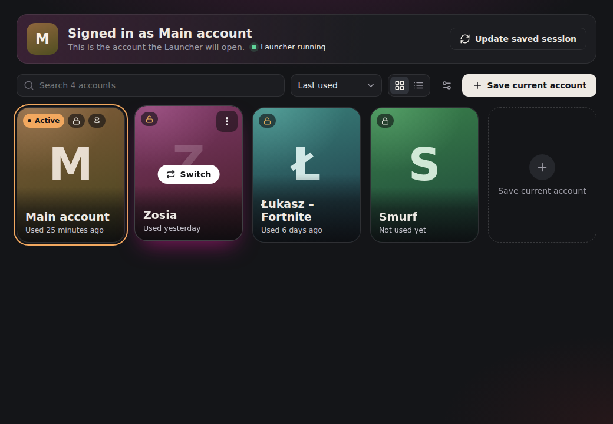

<div align="center">


# Epic Account Manager

**Switch between your Epic Games accounts in one click**  
**Works only for new Preview Launcher**


<br />

<a href="https://github.com/shdwgod/Epic-Account-Manager/releases/latest">
  
</a>

<br /><br />



</div>

---

## ✨ Features

- **One-click switching** between any number of saved Epic Games accounts
- **Live status bar** — see which saved account the Launcher is signed in to, whether it is running, launch it from the app, or save an account it doesn't know yet
- **Profile picker UI** — big profile tiles (or a compact list), search, sorting, pinning, per-profile colours and pictures; the background glow follows the active / hovered account
- **Optional password protection** — protect each profile with its own password (with a strength meter), or turn passwords off in Settings and switch with a single click
- **Smart saving** — re-saving the account you are signed in to updates its existing profile, and you get a clear warning before a profile would be replaced by a different account
- **Wrong password? Retry in place** — errors appear inside the dialog instead of closing it
- **Keyboard friendly** — `Ctrl+F` search, `Ctrl+N` save account, `Ctrl+,` settings, arrow keys move between tiles, right-click opens the profile menu
- **Auto-launch** the Epic Games Launcher after switching (optional); if it cannot be started the switch still counts and you get a warning
- **Safe by design** — runs fully offline, nothing is sent anywhere
- **Automatic backups** — the Launcher's previous session data is moved to a backup folder, never deleted outright
- **Portable** — a single small `.exe`, no installer, no Node.js, no Electron

## 🧠 How it works

The Epic Games Launcher remembers who is signed in using:

1. a credential stored in **Windows Credential Manager** (`com.epicgames.eglv2.prod`), and
2. session files in `%LOCALAPPDATA%\com.epicgames.eglv2\auth`.

When you click **Save current account**, the app closes the Launcher, takes a snapshot of both, encrypts it and stores it as a profile. When you click **Switch**, it closes the Launcher, moves the current `auth` folder to a backup, restores the selected profile's snapshot, and (optionally) starts the Launcher again — now signed in to that account.

Profiles are encrypted either with your password (protected profiles) or with Windows DPAPI only (password-free profiles) — see [Security](#-security).

## 🚀 Getting started

### Download

Download `Epic-Account-Manager-vX.Y.Z-windows.zip` from the [Releases page](https://github.com/shdwgod/Epic-Account-Manager/releases), unzip it and run **Epic Account Manager.exe**. Nothing to install. Each release also lists SHA-256 checksums in `SHA256SUMS.txt`. Needs the Microsoft Edge WebView2 runtime, which is built into Windows 11 and most Windows 10 installs.

### Build from source

Requirements: Windows 10 / 11, Epic Games Launcher, [Rust](https://rustup.rs) (stable, MSVC toolchain).

```bash
cargo run --release     # run
cargo build --release   # -> target/release/epic-account-manager.exe
cargo test              # core logic tests
```

### Working on the UI without Windows

The UI is plain HTML/CSS/JS in `ui/` and is embedded into the exe at build time. To iterate on it in a normal browser with a fake backend:

```bash
node ui-dev/serve.mjs     # http://localhost:5173
# options: ?empty  ?signedout  ?unsaved
```

## 📖 Usage

1. Sign in to the Epic Games Launcher with the first account (tick **Remember me**).
2. In the app click **Save current account**, give it a name and — if passwords are enabled — set a password.
3. Sign out in the Launcher, sign in to your next account and save it the same way.
4. From now on just click a profile tile. Protected profiles ask for their password, password-free profiles switch immediately.

### Switching without a password

1. Open **Settings** and turn off **Require a password**.
2. Save your accounts — you will no longer be asked for a password, and the cards show **No password**.
3. Already have protected profiles? Open the `⋯` menu on a card → **Remove password** (needs the current password once).

You can mix both modes: turn the setting back on, or use `⋯` → **Set password** on any password-free profile to protect it again.

**Tips**

- Right-click a tile (or use its `⋯` menu) → *Edit profile* to rename it and change its picture or colour; there you can also pin it, refresh its saved session, set / remove its password or delete it.
- Pinned profiles always stay at the top.
- Open **Settings** to enable/disable the password requirement and auto-launch, set the Launcher path manually, or open the data folder.

## 🗂 Where data is stored

| What | Location |
| --- | --- |
| Profiles & settings | `%USERPROFILE%\EpicAccountManager\accounts.json` |
| Session backups (last 3) | `%USERPROFILE%\EpicAccountManager\backup\` |

## 🔒 Security

- **Protected profiles:** encrypted with a key derived from **your password** using `scrypt`, authenticated with HMAC-SHA256, and additionally wrapped with **Windows DPAPI**, so they can only be opened by your Windows user account.
- **Password-free profiles:** protected by **Windows DPAPI only**. They cannot be read on another PC or by another Windows user, but anyone using your unlocked Windows account can switch to them without a password. Use this mode only on a PC you trust.
- The app never talks to the network and has no telemetry.
- The UI runs in a WebView2 window with a strict Content-Security-Policy (no inline scripts or styles, no remote content).
- Anyone with access to your unlocked Windows session *and* the profile password (or, for password-free profiles, just the session) could use a saved session, so choose strong passwords for accounts you care about.

## 🛠 Troubleshooting

| Problem | Fix |
| --- | --- |
| Launcher still opens the old account | Re-save the profile: sign in to that account in the Launcher, then click **Save current account** again. Saved tokens can expire when Epic rotates them. |
| "Wrong password" | Passwords are case-sensitive and cannot be recovered. Delete the profile and save it again. |
| "A password is required" when saving | **Require a password** is turned on in Settings. Turn it off to save profiles without a password. |
| "Could not reset: EBWebView" | The folder was in use. Close any leftover Epic processes and try again. |
| Launcher not found | Open **Settings → Browse** and select `EpicGamesLauncher.exe`. |
| Windows SmartScreen warns about the `.exe` | The build is not code-signed. Click **More info → Run anyway**. |

## 📁 Project structure

```
├── src/
│   ├── app.rs        # Commands the UI calls (save, switch, setMeta, ...)
│   ├── store.rs      # accounts.json, atomic writes, backups
│   ├── crypto.rs     # scrypt + HMAC + DPAPI profile encryption
│   ├── snapshot.rs   # Launcher session snapshot / restore
│   ├── shell.rs      # Window, WebView2, IPC bridge (Windows)
│   └── winplat.rs    # Windows APIs: Credential Manager, processes (Windows)
├── ui/
│   ├── index.html    # App shell
│   ├── styles.css    # Styling
│   ├── strings.js    # All user-facing text
│   └── renderer.js   # UI logic
├── ui-dev/           # Browser preview with a fake backend
├── tests/            # Integration tests of the core logic
└── docs/             # Logo and screenshot used in this README
```

## ⚠️ Disclaimer

This is an unofficial community project and is **not affiliated with, endorsed by, or sponsored by Epic Games, Inc.** *Epic Games* and the *Epic Games Launcher* are trademarks of Epic Games, Inc.

