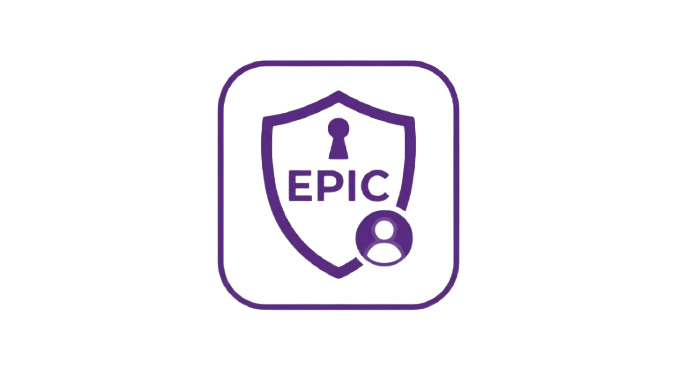
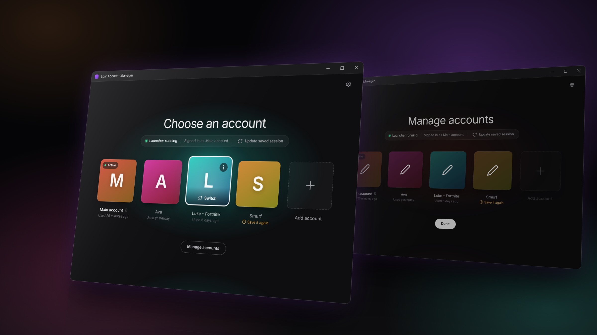

<div align="center">



# Epic Account Manager

**Switch between your Epic Games accounts in one click.**


<a href="https://github.com/shdwgod/Epic-Account-Manager/releases/latest">
  
</a>

<br /><br />



</div>

<br />

## Features

- **One click** to switch between any number of saved accounts
- **No passwords to type**: sessions are saved with Windows DPAPI
- **Profile picker UI** with colours, pictures, pinning and search
- **Offline and tiny**: one `.exe`, no installer, no Node.js, no Electron
- **Safe**: the previous session is backed up before every switch

> Works with the new **Preview Launcher** only.

## Getting started

1. Sign in to the Epic Games Launcher and tick **Remember me**.
2. Open the app and press **Save this account**.
3. Sign out, sign in to the next account and save it too.
4. From now on, click an account to switch to it.

Download the zip from [Releases](https://github.com/shdwgod/Epic-Account-Manager/releases), unzip it and run **Epic Account Manager.exe**. It needs the Microsoft Edge WebView2 runtime, which comes with Windows 11 and most Windows 10 installs.

**Shortcuts:** `Ctrl+F` search · `Ctrl+N` save account · `Ctrl+,` settings · `Esc` leave manage mode · right-click a tile for more

## Build from source

Needs Windows 10/11 and [Rust](https://rustup.rs) (stable, MSVC).

```bash
cargo run --release     # run
cargo build --release   # target/release/epic-account-manager.exe
cargo test              # core logic tests
```

The UI is plain HTML, CSS and JS in `ui/`. To work on it in a browser with a fake backend:

```bash
node ui-dev/serve.mjs   # http://localhost:5173  (?empty ?signedout ?unsaved ?many ?nolauncher)
```

## How it works

The Launcher keeps you signed in with a Windows Credential Manager entry plus session files in `%LOCALAPPDATA%\com.epicgames.eglv2\auth`. Saving takes an encrypted snapshot of both. Switching closes the Launcher, backs up the current session, restores the chosen snapshot and (optionally) starts the Launcher again.

Data lives in `%LOCALAPPDATA%\EpicAccountManager`: `accounts.json`, the last 3 session backups and the WebView2 cache.

## Security

- Profiles are encrypted with **Windows DPAPI**: they can't be read on another PC or by another Windows user.
- Anyone using your unlocked Windows account can switch to a saved profile, so use the app on a PC you trust.
- No network access and no telemetry. The UI runs under a strict Content-Security-Policy.

## Troubleshooting

| Problem | Fix |
| --- | --- |
| The Launcher opens the old account | Sign in to that account, then use **Update saved session** (saved tokens can expire). |
| An account shows a warning | It was saved with a password by an older version. Sign in to it and use **Update saved session**. |
| Launcher not found | Open **Settings** and choose `EpicGamesLauncher.exe`. |
| SmartScreen warns about the `.exe` | The build isn't code-signed. Click **More info → Run anyway**. |

## Disclaimer

Unofficial community project, **not affiliated with, endorsed by, or sponsored by Epic Games, Inc.** *Epic Games* and the *Epic Games Launcher* are trademarks of Epic Games, Inc.

## License

[MIT](LICENSE)
