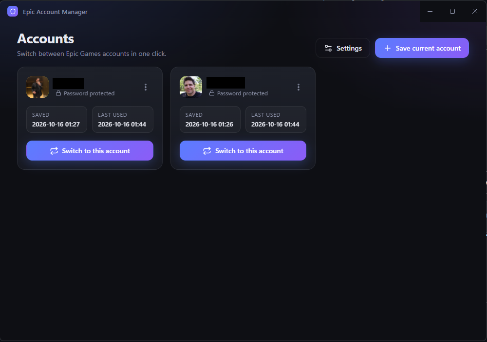

<div align="center">


# Epic-Account-Manager

**Switch between your Epic Games accounts in one click**  
**Works only for new Preview Launcher**


<br />

<a href="https://github.com/shdwgod/Epic-Account-Manager/releases/download/v1.0.0/Epic.Account.Manager.1.0.0.exe">
  
</a>

<br /><br />



</div>

---

## ✨ Features

- **One-click switching** between any number of saved Epic Games accounts
- **Optional password protection** — protect each profile with its own password, or turn passwords off in Settings and switch with a single click
- **Per-profile control** — add or remove the password of any profile later from its `⋯` menu, and see at a glance which profiles are protected (🔒) and which are not (🔓)
- **Custom pictures** — pick an image from your computer for each account
- **Clean dark UI** with profile cards, rename / delete, and toast notifications
- **Auto-launch** the Epic Games Launcher after switching (optional)
- **Safe by design** — runs fully offline, nothing is sent anywhere
- **Automatic backups** — the Launcher's previous session data is moved to a backup folder, never deleted outright
- **Portable** — build a single `.exe` that needs no installation

## 🧠 How it works

The Epic Games Launcher remembers who is signed in using:

1. a credential stored in **Windows Credential Manager** (`com.epicgames.eglv2.prod`), and
2. session files in `%LOCALAPPDATA%\com.epicgames.eglv2\auth`.

When you click **Save current account**, the app closes the Launcher, takes a snapshot of both, encrypts it and stores it as a profile. When you click **Switch**, it closes the Launcher, moves the current `auth` and `EBWebView` folders to a backup, restores the selected profile's snapshot, and (optionally) starts the Launcher again — now signed in to that account.

Profiles are encrypted either with your password (protected profiles) or with Windows DPAPI only (password-free profiles) — see [Security](#-security).

## 🚀 Getting started

### Download

The easiest way: **[download the portable `.exe` (v1.0.0)](https://github.com/shdwgod/Epic-Account-Manager/releases/download/v1.0.0/Epic.Account.Manager.1.0.0.exe)**, run it, and you're done — no installation and no Node.js needed. All versions are listed on the [Releases page](https://github.com/shdwgod/Epic-Account-Manager/releases).

### Requirements

- Windows 10 / 11
- Epic Games Launcher installed
- [Node.js](https://nodejs.org) (LTS) — only needed to run from source or build the `.exe` yourself

### Run from source

```bash
git clone https://github.com/shdwgod/Epic-Account-Manager.git
cd Epic-Account-Manager
npm install
npm start
```

### Build a portable `.exe`

```bash
npm run dist
```

The executable is created in the `dist` folder.

## 📖 Usage

1. Sign in to the Epic Games Launcher with the first account (tick **Remember me**).
2. In the app click **Save current account**, give it a name and — if passwords are enabled — set a password.
3. Sign out in the Launcher, sign in to your next account and save it the same way.
4. From now on just press **Switch to this account** on the profile card. Protected profiles ask for their password, password-free profiles switch immediately.

### Switching without a password

1. Open **Settings** and turn off **Require a password**.
2. Save your accounts — you will no longer be asked for a password, and the cards show **No password**.
3. Already have protected profiles? Open the `⋯` menu on a card → **Remove password** (needs the current password once).

You can mix both modes: turn the setting back on, or use `⋯` → **Set password** on any password-free profile to protect it again.

**Tips**

- Click an avatar (or use the `⋯` menu → *Change picture*) to set a custom image.
- Use the `⋯` menu to rename, delete, or set/remove the password of a profile.
- Open **Settings** to enable/disable the password requirement and auto-launch, set the Launcher path manually, or open the data folder.

## 🗂 Where data is stored

| What | Location |
| --- | --- |
| Profiles & settings | `%USERPROFILE%\EpicAccountManager\accounts.json` |
| Session backups (last 3) | `%USERPROFILE%\EpicAccountManager\backup\` |

## 🔒 Security

- **Protected profiles:** encrypted with a key derived from **your password** using `scrypt`, authenticated with HMAC-SHA256, and additionally wrapped with **Windows DPAPI**, so they can only be opened by your Windows user account.
- **Password-free profiles:** protected by **Windows DPAPI only**. They cannot be read on another PC or by another Windows user, but anyone using your unlocked Windows account can switch to them without a password. Use this mode only on a PC you trust.
- The app never talks to the network and has no telemetry.
- The Electron window runs with `contextIsolation` and `sandbox` enabled and a strict Content-Security-Policy.
- Anyone with access to your unlocked Windows session *and* the profile password (or, for password-free profiles, just the session) could use a saved session, so choose strong passwords for accounts you care about.

## 🛠 Troubleshooting

| Problem | Fix |
| --- | --- |
| Launcher still opens the old account | Re-save the profile: sign in to that account in the Launcher, then click **Save current account** again. Saved tokens can expire when Epic rotates them. |
| "Wrong password" | Passwords are case-sensitive and cannot be recovered. Delete the profile and save it again. |
| "A password is required" when saving | **Require a password** is turned on in Settings. Turn it off to save profiles without a password. |
| "Could not reset: EBWebView" | The folder was in use. Close any leftover Epic processes and try again. |
| Launcher not found | Open **Settings → Browse** and select `EpicGamesLauncher.exe`. |
| `Cannot create symbolic link` during `npm run dist` | Enable **Developer Mode** in Windows settings (or run the terminal as administrator), delete `%LOCALAPPDATA%\electron-builder\Cache\winCodeSign` and build again. |
| Windows SmartScreen warns about the `.exe` | The build is not code-signed. Click **More info → Run anyway**. |

## 📁 Project structure

```
├── main.js        # Electron main process: Windows APIs, encryption, profile logic
├── preload.js     # Secure bridge between UI and main process
├── index.html     # App shell
├── renderer.js    # UI logic
├── styles.css     # Styling
├── icon.ico       # Window / taskbar / executable icon
├── docs/          # Logo and screenshot used in this README
└── package.json
```

## ⚠️ Disclaimer

This is an unofficial community project and is **not affiliated with, endorsed by, or sponsored by Epic Games, Inc.** *Epic Games* and the *Epic Games Launcher* are trademarks of Epic Games, Inc.